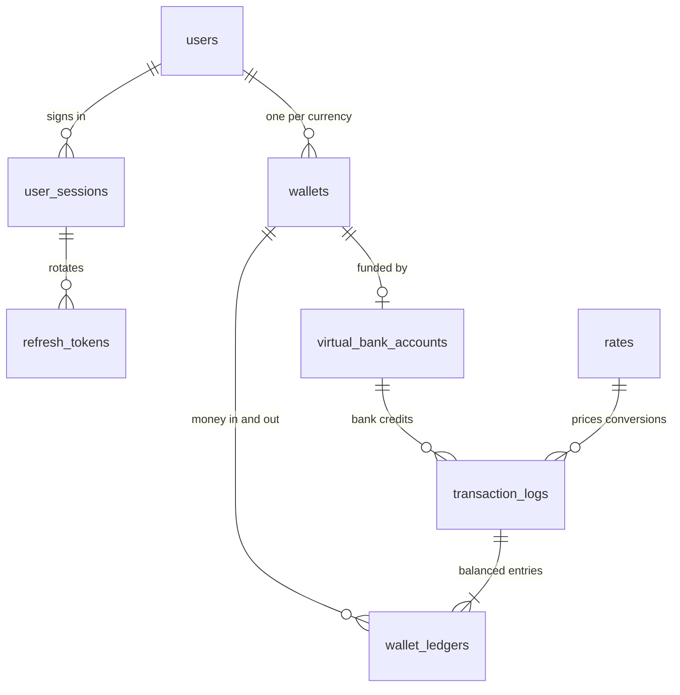

# BorderFlow

**Operation Borderless:** a stablecoin-powered cross-border payment sandbox API.

BorderFlow lets a client open wallets in five mock stablecoins (`cNGN`, `cGHS`, `cXAF`, `USDx`, `EURx`), deposit into them, swap between them at live FX rates, send to other users in the same or a different currency, and read balances, rates and transaction history. Every money movement is recorded in a double-entry wallet ledger, committed atomically, and protected against duplicate processing.

All tokens and funding are simulated. Each stablecoin is assumed to track its fiat currency 1:1 (cNGN ↔ NGN, USDx ↔ USD, and so on).

- [What the API does](#what-the-api-does)
- [Tech stack](#tech-stack)
- [Why PostgreSQL](#why-postgresql)
- [Setup and run](#setup-and-run)
- [Running the tests](#running-the-tests)
- [Endpoint walkthrough](#endpoint-walkthrough)
- [Data model](#data-model)
- [Money precision](#money-precision)
- [Idempotency](#idempotency)
- [Concurrency](#concurrency)
- [FX rates and failures](#fx-rates-and-failures)
- [Beyond the brief](#beyond-the-brief)
- [API documentation](#api-documentation)
- [Assumptions, limitations and next steps](#assumptions-limitations-and-next-steps)

## What the API does

| Requirement                                                     | How BorderFlow does it                                                                                                                    |
| --------------------------------------------------------------- | ----------------------------------------------------------------------------------------------------------------------------------------- |
| Create wallets with an email or mobile number, no duplicates    | Sign up with name, unique phone and optional unique email; open one wallet per stablecoin (a second wallet in the same currency is `409`) |
| A balance per stablecoin, plus the total in USD                 | `GET /v1/wallets` returns every wallet's balance and `totalUsd`                                                                           |
| Deposits                                                        | `POST /v1/wallets/:walletId/deposits` credits immediately and records a transaction                                                       |
| Swaps with FX rates, no negative balances, no double processing | Quote, then swap at the locked rate; balances are checked under row locks; every request carries an idempotency key                       |
| Transfers in the same or a different currency                   | `POST /v1/transfers` converts automatically when the wallets' currencies differ and records both sides, the rate and the time             |
| History, single lookup, current rates                           | Paginated, filterable `GET /v1/transactions`; `GET /v1/transactions/:id`; `GET /v1/rates` with refresh times                              |

## Tech stack

| Area             | Choice                                                                        |
| ---------------- | ----------------------------------------------------------------------------- |
| Language/runtime | TypeScript (strict) on Node.js 24 LTS                                         |
| Framework        | NestJS 10, built with SWC                                                     |
| Database         | PostgreSQL 17 via TypeORM, schema managed by migrations                       |
| Cache and queue  | Redis 7: rate and quote cache; BullMQ for background virtual-account issuance |
| Scheduling       | `@nestjs/schedule` cron job refreshing rates every 6 hours                    |
| Money maths      | `decimal.js` (no floating point)                                              |
| Tests            | Jest + Supertest against real PostgreSQL and Redis                            |
| Tooling          | Yarn, ESLint, Prettier, Docker Compose, GitHub Actions CI                     |
| API docs         | OpenAPI (Swagger UI)                                                          |

## Why PostgreSQL

Money movement needs guarantees a document store makes awkward:

- **Atomic multi-row writes.** A conversion debits one wallet, credits another and moves two system balances. All four ledger rows, the balances and the transaction log commit together or not at all.
- **Row locks.** `SELECT … FOR UPDATE` serializes competing spends from the same wallet.
- **Exact decimals.** `NUMERIC(30,6)` stores balances without rounding drift.
- **Constraints as a safety net.** Unique keys, foreign keys, CHECKs (for example, a user wallet cannot go negative) and triggers that refuse unbalanced or edited ledger rows.

Redis is used only where it earns its place: sharing the current rate selection and short-lived quotes across instances, and backing the BullMQ queue that issues virtual bank accounts in the background. PostgreSQL stays the source of truth.

## Setup and run

### One command with Docker

Prerequisites: Docker with Compose v2.

```bash
export AUTH_JWT_SECRET="$(node -e "console.log(require('node:crypto').randomBytes(64).toString('base64url'))")"
docker compose up
```

Compose starts PostgreSQL and Redis, builds the API, runs the migrations on startup (which also seed the `SYSTEM` wallets and the fixed rate table) and serves:

- API: `http://localhost:3000/v1`
- Swagger UI: `http://localhost:3000/docs` (spec also committed at [docs/openapi.json](docs/openapi.json))
- Health: `http://localhost:3000/health/live` and `/health/ready`

Options:

- `FX_MODE=fixed docker compose up` uses the fixed rate table instead of the live provider (fully offline).
- Set `VBA_WEBHOOK_SECRET` (32+ random characters) to enable the bank-credit webhook.
- Host ports used: API `3000`, PostgreSQL `5434`, Redis `6379`. Stop anything already bound to them first.

### Local development

```bash
corepack enable
yarn install --frozen-lockfile
cp .env.example .env            # then set AUTH_JWT_SECRET (and VBA_WEBHOOK_SECRET)
docker compose up -d database redis
yarn start:dev
```

Configuration is validated at startup; see [.env.example](.env.example) for every variable.

### Migrations

| Script                                                       | Effect                                                        |
| ------------------------------------------------------------ | ------------------------------------------------------------- |
| `yarn migration:run` / `migration:show` / `migration:revert` | Apply, list, or roll back migrations                          |
| `yarn migration` / `yarn migration:run:prod`                 | Build then apply / apply compiled migrations from `dist/`     |
| `yarn migration:generate -- AddWalletLimits`                 | Diff entities against the database into a new named migration |
| `yarn migration:create -- BackfillReferences`                | Empty named migration for hand-written SQL                    |

The API also applies pending migrations on startup.

## Running the tests

```bash
yarn test
```

The runner starts a throwaway PostgreSQL and Redis with Docker Compose on free ports, runs the unit and API suites, then removes them (Docker must be running). The suites never call the public FX provider.

The 130 tests cover:

- Precision and validation, plus duplicate identities and wallets
- Every one of the 20 conversion directions, deposits, swaps, and both kinds of transfer
- Idempotent replay and conflicting keys; concurrent duplicate requests and competing spends
- Opposing transfers (lock ordering) and rollback when a ledger write fails
- Ledger and immutability triggers
- Quote locking, expiry and mismatch; FX provider failure and fallback; Redis outage; replay after restart
- History pagination and filters
- Background issuance of virtual bank accounts with retries, and the signed webhook

After every test, the suite checks that each transaction's ledger nets to zero, every wallet balance equals the sum of its ledger, and no user wallet is negative.

Other checks: `yarn typecheck`, `yarn lint`, `yarn format:check`, `yarn build`. CI runs all of them.

## Endpoint walkthrough

All private routes need `Authorization: Bearer <accessToken>`. Every money request needs an `Idempotency-Key` header (8–128 letters, digits, `_` or `-`). The examples are real responses from `FX_MODE=fixed`, trimmed where marked `…`.

| Method | Route                                        | Purpose                                                    |
| ------ | -------------------------------------------- | ---------------------------------------------------------- |
| POST   | `/v1/auth/register`                          | Sign up (name, phone, optional email, password)            |
| POST   | `/v1/auth/login`                             | Sign in with phone or email                                |
| POST   | `/v1/auth/refresh`                           | Rotate tokens                                              |
| GET    | `/v1/auth/profile`                           | Current user and their wallet IDs                          |
| POST   | `/v1/auth/logout`                            | End the session                                            |
| POST   | `/v1/wallets`                                | Open a wallet `{ "currency" }`                             |
| GET    | `/v1/wallets`                                | All wallets, balances and `totalUsd`                       |
| GET    | `/v1/wallets/:walletId`                      | One wallet, with its virtual bank account                  |
| POST   | `/v1/wallets/:walletId/deposits`             | Simulated deposit                                          |
| GET    | `/v1/rates`                                  | All 25 rate pairs with refresh times                       |
| POST   | `/v1/rates/quotes`                           | Lock a rate for a swap or transfer                         |
| POST   | `/v1/wallets/:walletId/swaps`                | Swap into another of your wallets                          |
| POST   | `/v1/transfers`                              | Send to another user's wallet                              |
| GET    | `/v1/transactions`                           | History: `walletId`, `type`, `currency`, `limit`, `cursor` |
| GET    | `/v1/transactions/:transactionId`            | One transaction                                            |
| POST   | `/v1/wallets/:walletId/virtual-bank-account` | Re-request a pending or failed virtual bank account        |
| POST   | `/v1/webhooks/virtual-bank-accounts/credits` | Signed bank-credit callback                                |

Every response uses one envelope: `{ status, data, success, message }`. Errors use `{ status: "failed", error, success: false, message, errorCode }`.

### 1. Sign up

```bash
curl -s http://localhost:3000/v1/auth/register -H 'Content-Type: application/json' \
  -d '{"firstName":"Ada","lastName":"Okafor","email":"alice@example.com","phone":"+2348012345678","password":"alice-demo-password-2026"}'
```

```json
{
  "status": 201,
  "data": {
    "accessToken": "<jwt>",
    "refreshToken": "<refresh-token>",
    "tokenType": "Bearer",
    "expiresAt": "2026-10-30T02:13:59.000Z",
    "user": {
      "id": "63fbaa75-d652-465a-94d6-777152d7ee77",
      "firstName": "Ada",
      "lastName": "Okafor",
      "email": "alice@example.com",
      "phone": "+2348012345678",
      "wallets": []
    }
  },
  "success": true,
  "message": "Account created"
}
```

Registering the same email or phone again returns `409 This identity is already registered`.

### 2. Open wallets

One request per currency. The wallet's virtual bank account starts `PENDING` and is issued in the background (see [Beyond the brief](#beyond-the-brief)).

```bash
curl -s http://localhost:3000/v1/wallets -H "Authorization: Bearer $TOKEN" \
  -H 'Content-Type: application/json' -d '{"currency":"cNGN"}'
```

```json
{
  "status": 201,
  "data": {
    "id": "9c3b6f9a-452c-4705-b5e5-8bb8a7eb4343",
    "currency": "cNGN",
    "balance": "0.000000",
    "virtualBankAccount": { "status": "PENDING", "accountNumber": null, … }
  },
  "success": true,
  "message": "Wallet created"
}
```

A second cNGN wallet for the same user returns `409 You already have a cNGN wallet`.

### 3. Deposit

```bash
curl -s "http://localhost:3000/v1/wallets/$NGN_WALLET/deposits" -H "Authorization: Bearer $TOKEN" \
  -H 'Content-Type: application/json' -H 'Idempotency-Key: alice-deposit-0001' -d '{"amount":"150000"}'
```

```json
{
  "status": 201,
  "data": {
    "id": "d4fa047b-5f8b-4b18-9e73-eae0954bd8b1",
    "reference": "TXN-20261030-48AF62C81488",
    "type": "DEPOSIT",
    "channel": "API",
    "description": "Deposit of 150000.000000 cNGN",
    "sourceWalletId": null,
    "destinationWalletId": "9c3b6f9a-452c-4705-b5e5-8bb8a7eb4343",
    "sourceCurrency": "cNGN",
    "destinationCurrency": "cNGN",
    "sourceAmount": "150000.000000",
    "destinationAmount": "150000.000000",
    "rate": "1.000000000000000000",
    "createdAt": "2026-10-30T01:14:01.762Z",
    …
  },
  "success": true,
  "message": "Deposit completed"
}
```

Sending it again with the same key (even as `"150000.000000"`) returns the same transaction with header `Idempotency-Replayed: true`. The same key with a different amount returns `409 This idempotency key belongs to a different request`.

### 4. Rates

```bash
curl -s http://localhost:3000/v1/rates
```

```json
{
  "status": 200,
  "data": {
    "source": "FIXED",
    "provider": "sandbox-v1",
    "rates": [
      {
        "fromCurrency": "cNGN",
        "toCurrency": "USDx",
        "rate": "0.001000000000000000",
        "source": "FIXED",
        "refreshedAt": null,
        "configuredAt": "2026-10-30T01:13:33.199Z",
        …
      },
      …
    ]
  },
  "success": true,
  "message": ""
}
```

All 25 pairs are returned. With live rates, `source` is `LIVE` and each pair carries `refreshedAt` (when it was fetched) and `observedDate` (the provider's date).

### 5. Swap: quote, then execute

```bash
curl -s http://localhost:3000/v1/rates/quotes -H "Authorization: Bearer $TOKEN" -H 'Content-Type: application/json' \
  -d "{\"fromWalletId\":\"$NGN_WALLET\",\"toWalletId\":\"$USD_WALLET\",\"amount\":\"50000\"}"
```

```json
{
  "status": 200,
  "data": {
    "quoteId": "6d4a18a4-469b-4f3f-adcd-f4adca4aef7a",
    "type": "SWAP",
    "fromCurrency": "cNGN",
    "toCurrency": "USDx",
    "sourceAmount": "50000.000000",
    "destinationAmount": "50.000000",
    "rate": "0.001000000000000000",
    "expiresAt": "2026-10-30T01:19:01.811Z",
    "sourceRateId": "e4810eda-46ce-4f17-b5d1-23779d97b951",
    "destinationRateId": "d0e5b599-40e4-42d3-8456-17f115d7a0aa",
    …
  },
  "success": true,
  "message": "Rate quote created"
}
```

```bash
curl -s "http://localhost:3000/v1/wallets/$NGN_WALLET/swaps" -H "Authorization: Bearer $TOKEN" \
  -H 'Content-Type: application/json' -H 'Idempotency-Key: alice-swap-0001' \
  -d "{\"toWalletId\":\"$USD_WALLET\",\"amount\":\"50000\",\"quoteId\":\"$QUOTE_ID\"}"
```

```json
{
  "status": 201,
  "data": {
    "reference": "TXN-20261030-9A5FE2334EDF",
    "type": "SWAP",
    "description": "Swap of 50000.000000 cNGN to 50.000000 USDx",
    "sourceAmount": "50000.000000",
    "destinationAmount": "50.000000",
    "rate": "0.001000000000000000",
    "sourceRateId": "e4810eda-46ce-4f17-b5d1-23779d97b951",
    "destinationRateId": "d0e5b599-40e4-42d3-8456-17f115d7a0aa",
    …
  },
  "success": true,
  "message": "Swap completed"
}
```

Swapping more than the balance returns `422 The source balance cannot cover this amount`. An expired quote returns `409 The conversion rate has expired. Please request a new rate.`

### 6. Transfer

Quote against the recipient's wallet, then send. A different currency converts automatically. The same currency needs no quote.

```bash
curl -s http://localhost:3000/v1/transfers -H "Authorization: Bearer $TOKEN" \
  -H 'Content-Type: application/json' -H 'Idempotency-Key: alice-bob-0001' \
  -d "{\"fromWalletId\":\"$NGN_WALLET\",\"toWalletId\":\"$BOB_GHS_WALLET\",\"amount\":\"10000\",\"quoteId\":\"$QUOTE_ID\"}"
```

```json
{
  "status": 201,
  "data": {
    "reference": "TXN-20261030-C4A03652EC6E",
    "type": "TRANSFER",
    "description": "Transfer of 10000.000000 cNGN received as 100.000000 cGHS",
    "sourceWalletId": "9c3b6f9a-452c-4705-b5e5-8bb8a7eb4343",
    "destinationWalletId": "afed2ab0-9dd8-4470-97bf-45dc9aa6601c",
    "sourceCurrency": "cNGN",
    "destinationCurrency": "cGHS",
    "sourceAmount": "10000.000000",
    "destinationAmount": "100.000000",
    "rate": "0.010000000000000000",
    "createdAt": "2026-10-30T01:14:01.880Z",
    …
  },
  "success": true,
  "message": "Transfer completed"
}
```

Sending to one of your own wallets returns `422` (use a swap). A cross-currency transfer without a quote returns `400 Get a rate quote before converting or sending across currencies`.

### 7. Balances and total in USD

```bash
curl -s http://localhost:3000/v1/wallets -H "Authorization: Bearer $TOKEN"
```

```json
{
  "status": 200,
  "data": {
    "wallets": [
      {
        "id": "9c3b6f9a-452c-4705-b5e5-8bb8a7eb4343",
        "currency": "cNGN",
        "balance": "110000.000000",
        "virtualBankAccount": {
          "status": "ACTIVE",
          "accountNumber": "9458525389",
          "accountName": "BorderFlow / Ada Okafor",
          "bankName": "BorderFlow Sandbox Bank",
          …
        }
      },
      …
    ],
    "totalUsd": "160.000000",
    "valuation": { "source": "FIXED", … }
  },
  "success": true,
  "message": ""
}
```

### 8. History and a single transaction

```bash
curl -s "http://localhost:3000/v1/transactions?type=TRANSFER&currency=cGHS&limit=20" -H "Authorization: Bearer $TOKEN"
curl -s "http://localhost:3000/v1/transactions/$TRANSACTION_ID" -H "Authorization: Bearer $TOKEN"
```

History returns `{ items, hasMore, nextCursor }`, newest first, and each item has a `direction` (`SENT`, `RECEIVED` or `INTERNAL`). Pass `nextCursor` as `cursor` for the next page. `limit` defaults to 20 (maximum 100), and `walletId` narrows history to one of your wallets. Both participants of a transfer can read it; anyone else gets `404`.

## Data model



| Table                   | Holds                                                                                                                                           |
| ----------------------- | ----------------------------------------------------------------------------------------------------------------------------------------------- |
| `users`                 | First and last name, unique phone, optional unique email, bcrypt password hash                                                                  |
| `user_sessions`         | One login session: expiry and revocation                                                                                                        |
| `refresh_tokens`        | SHA-256 hashes of single-use refresh tokens                                                                                                     |
| `wallets`               | The money: one `USER` wallet per user per currency with its `balance`; one `SYSTEM` wallet per currency as the counterparty for deposits and FX |
| `wallet_ledgers`        | Every movement: `CREDIT`/`DEBIT`, amount, balance before and after, linked to its transaction log                                               |
| `transaction_logs`      | One row per deposit, swap or transfer: reference, type, channel, description, wallets, both amounts and currencies, rate, rates used, key, time |
| `rates`                 | Units of each currency per 1 USD, one row per currency per refresh (`LIVE` or `FIXED`), with fetch and observation time                         |
| `virtual_bank_accounts` | Bank account that funds a wallet: `PENDING` → `ACTIVE` (or `FAILED`), account number, name, bank                                                |

Every constraint and index is named (`pk_`, `fk_`, `uq_`, `chk_`, `idx_`), and foreign keys on money tables never cascade. Key indexes:

| Index                                                                                                       | Purpose                          |
| ----------------------------------------------------------------------------------------------------------- | -------------------------------- |
| `uq_wallets_user_id_currency`                                                                               | One wallet per user per currency |
| `idx_transaction_logs_source_wallet_id_created_at`, `idx_transaction_logs_destination_wallet_id_created_at` | Newest-first history             |
| `idx_wallet_ledgers_wallet_id_created_at`                                                                   | Wallet statements                |
| `uq_transaction_logs_initiated_by_user_id_idempotency_key`                                                  | Idempotent retries               |
| `uq_transaction_logs_external_reference`                                                                    | Bank settlement IDs              |
| `idx_rates_currency_source_fetched_at`                                                                      | Latest rate per currency         |

`rates`, `transaction_logs` and `wallet_ledgers` are append-only (triggers reject updates and deletes). The schema lives in one migration, and the entity definitions match it exactly (`yarn typeorm schema:log` reports no changes).

## Money precision

- Amounts and balances are `NUMERIC(30,6)`; rates are `NUMERIC(38,18)`. In code they stay strings and `decimal.js` values. JavaScript `number` is never used for money.
- Request amounts must be decimal strings with at most six decimal places, positive, and no greater than `1000000000000000`. Scientific notation, numeric JSON and excess precision are rejected.
- A rate is truncated to 18 decimals, and that stored rate computes the credited amount, which rounds **down** to six decimals. A conversion that would credit less than `0.000001` is rejected.
- The USD total is summed unrounded and rounded once, half-even, to six decimals.

## Idempotency

- Deposits, swaps and transfers require an `Idempotency-Key`, stored on the transaction log and unique per user.
- The same key with an equivalent body (`1` and `1.000000` count as equal) returns the original result with `Idempotency-Replayed: true`, even after a restart or a rate change.
- The same key with a different operation, amount, wallets or quote returns `409`.
- A rejected request (for example, insufficient funds) commits nothing, so the key can be retried after funding.
- Concurrent duplicates are settled by the database's unique index: exactly one commits, and the rest replay it.
- Bank-credit webhooks use the provider's settlement ID the same way. A redelivery returns the original transaction with `duplicate: true`.

## Concurrency

- Each operation runs in one PostgreSQL transaction. It locks every wallet it touches with `SELECT … FOR UPDATE`, **in sorted ID order**, so opposing transfers cannot deadlock.
- Balances are checked on the locked rows, so two simultaneous spends of the same money cannot both succeed: one gets `422`.
- A deferred trigger refuses to commit any transaction whose ledger entries do not net to zero per currency. A CHECK constraint keeps user wallets from going negative.
- Lock and statement timeouts bound waiting. Deadlock or serialization errors are retried twice, then return `503`, so the client retries with the same key.

## FX rates and failures

- **Source:** the [Frankfurter](https://frankfurter.dev/) daily reference rates (`GET /v2/rates?base=USD&quotes=NGN,GHS,XAF,EUR`, no API key). Numbers are parsed as decimal strings and validated before being stored as `rates` rows.
- **Refresh:** a cron job (`ratesRefresh`, `FX_REFRESH_CRON`, default every 6 hours) fetches and stores new rates. Requests read the latest stored rows, shared through Redis.
- **Failure handling**, in order:
  1. Fresh `LIVE` rows (younger than `FX_REFRESH_SECONDS`) are used as `LIVE`.
  2. If they are stale, the API tries one refresh (2-second timeout).
  3. If that fails, it uses the last `LIVE` rows observed within seven days, marked `STALE_CACHE`.
  4. Otherwise it uses the seeded fixed rate table, marked `FIXED_FALLBACK`.
  5. If no complete rate set exists, rate-dependent requests return `503` and nothing is committed.
- **Quotes:** a quote locks the exact two `rates` rows and the credited amount in Redis for `FX_QUOTE_TTL_SECONDS` (default 300). Execution re-derives the amount from those rows and re-checks expiry after taking the locks. A newer market rate never changes a valid quote, and execution never fetches a new rate.
- **Redis outage:** rate reads and new quoted operations return `503` rather than repricing. Deposits, same-currency transfers and replays of committed requests keep working.

Fixed seed (units per USD): cNGN `1000`, cGHS `10`, cXAF `600`, USDx `1`, EURx `0.9`. These are illustrative values.

## Beyond the brief

- **Authentication:**
  - Bcrypt passwords and short-lived JWT access tokens.
  - Rotating single-use refresh tokens; reusing one revokes the whole session.
  - Logout, and a per-IP rate limit on the login endpoints.
  - Users can only see and move money from their own wallets.
- **Virtual bank accounts (VBA) for funding:**
  - Opening a wallet also creates its VBA (`PENDING`) in the same database transaction, and queues a BullMQ job.
  - The `VirtualBankAccountConsumer` asks the bank provider for an account in the user's name and marks it `ACTIVE`.
  - Failures retry with exponential backoff (`VBA_PROVISION_ATTEMPTS`, `VBA_PROVISION_BACKOFF_MS`), ending in `FAILED` with a reason. `POST /v1/wallets/:walletId/virtual-bank-account` re-requests it.
  - The bank is a sandbox implementation behind a `BankProvider` interface, so a real bank adapter can replace it.
- **Bank-credit webhook:**
  - `POST /v1/webhooks/virtual-bank-accounts/credits` must carry `X-Webhook-Signature`: the hex HMAC-SHA512 of the raw body using `VBA_WEBHOOK_SECRET`.
  - Each settlement ID credits once. A credit is recorded as a `DEPOSIT` with channel `VIRTUAL_ACCOUNT` and the sender details.
- **Dev tools (sandbox only):** `POST /v1/dev-tools/bank-credit-signatures` builds and signs a webhook body so you can test funding by hand. It returns `404` when `NODE_ENV=production`.

```bash
# Sign by hand instead of using dev tools:
BODY='{"settlementId":"STL-0001","accountNumber":"9458525389","amount":"25000.00"}'
SIG=$(printf '%s' "$BODY" | openssl dgst -sha512 -hmac "$VBA_WEBHOOK_SECRET" -hex | awk '{print $2}')
curl -s http://localhost:3000/v1/webhooks/virtual-bank-accounts/credits \
  -H 'Content-Type: application/json' -H "X-Webhook-Signature: $SIG" -d "$BODY"
```

## API documentation

- OpenAPI: Swagger UI at `/docs`, JSON at `/openapi.json`, committed as [docs/openapi.json](docs/openapi.json) (`yarn docs:generate`). Import it into Postman, Insomnia or any OpenAPI client.

## Assumptions, limitations and next steps

**Assumptions**

- Stablecoins are pegged 1:1 to their fiat currency, and every asset uses six decimal places, including cXAF. This is a sandbox policy, not a claim about real tokens.
- Deposits and bank credits are simulated; no real money or blockchain is involved.
- No fees, spreads or slippage: the credited amount is exactly the quoted conversion.
- Rates are daily reference rates. `GET /v1/rates` is informational; only a quote locks a price.

**Known limitations**

- One `SYSTEM` wallet per currency serializes deposits and conversions in that currency under heavy contention.
- With several API instances, each runs the rates cron. This only appends duplicate rate rows, but it is wasteful.
- Login rate limiting is per process.
- No email or phone verification, password reset, withdrawals, reversals or admin tooling.

**With more time**

- Verified identities (OTP), withdrawals to bank accounts, and reversals.
- Fees and spreads, and minimum-receive protection on quotes.
- A real bank provider adapter.
- Scheduled reconciliation of balances against the ledger.
- Distributed locking for the cron job, and an outbox for notifications.
